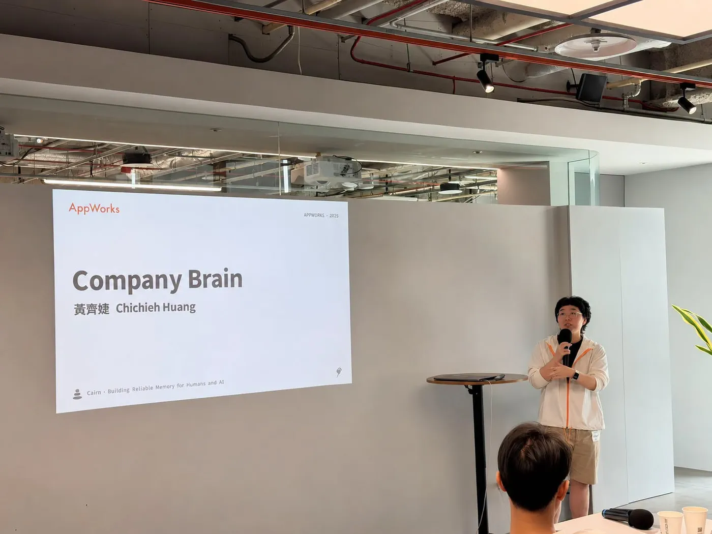
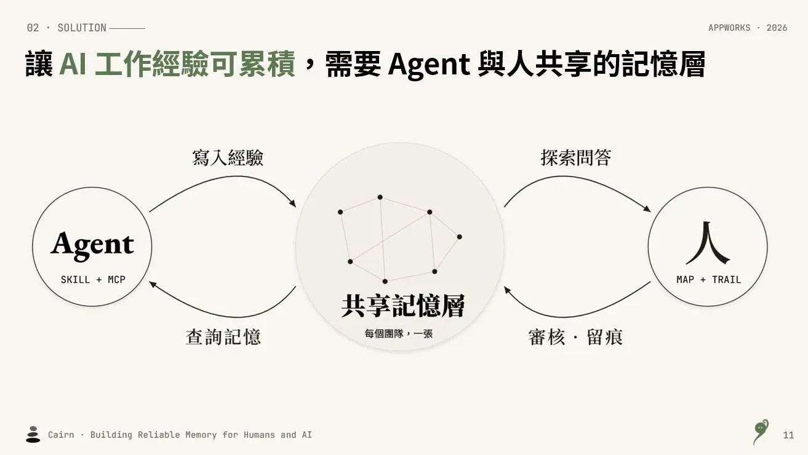
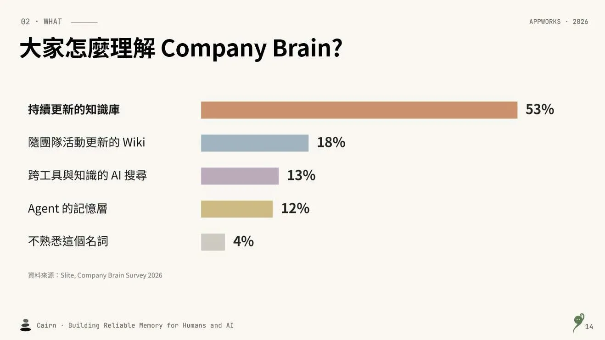
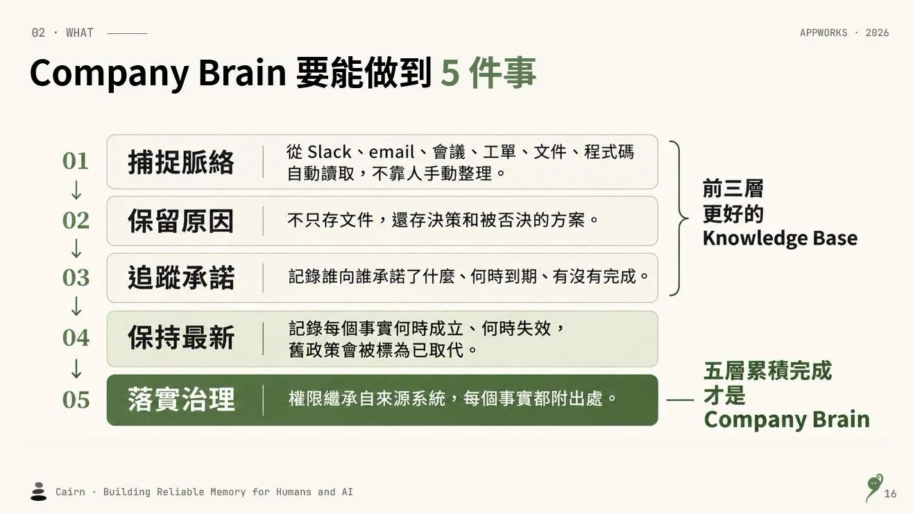

Last week I was really happy to be back at AppWorks' AI Founder Circle, talking with a group of founders about Company Brain 🙌

Since January, when we started raising our lobster (running OpenClaw), then went on to run a whole team of collaborating AI agents and stepped into pitfall after pitfall researching Agent Memory, one question has stayed with us: once AI is part of everyday work, how should a company actually accumulate its knowledge, decisions and experience? Preparing the slides for this talk was a good excuse to pull together, more completely than before, what I've come to understand about AI-native organizations and Company Brain.

Right now people define Company Brain in quite different ways. Some treat it as a knowledge base that keeps itself updated, some see it as AI search across tools, and some come at it from the Agent Memory angle. Each direction has its value. It really depends on how a company works and what problem it's trying to solve right now.

I opened the talk by asking everyone to imagine the daily operations of an AI-native company. Sales, product and support all have AI helping them, and agents are even starting to own parts of the work on their own. But if every agent is strong on its own, yet doesn't know what other teams have decided, what was promised to a customer, or how far a project has moved, then in the end people still have to sit in the middle, re-explaining things and passing messages along 😅 Just wiring Slack, the CRM and your documents together isn't enough to fix this. What the whole organization needs is a shared working context that keeps itself up to date and that everyone can actually trust.

I break my ideal Company Brain into five layers:

1. **Capture context**: Pull in the information scattered across Slack, meetings, documents and day-to-day work, without relying on someone to organize it by hand every time.
2. **Keep the reasons**: Record not only what was finally decided, but also why it was decided that way and which options were ruled out along the way.
3. **Track commitments**: Know who promised what, when it's due, and where it's currently stuck.
4. **Stay current**: When a direction or decision changes, tell which version is the one that counts now, so old and new information don't get mixed up.
5. **Permissions and governance**: Different employees and agents have different permissions. Who can see what, who can change what, and whose word makes something an official company decision all need to be managed.

Once you've done the first three, you already have a fairly complete knowledge base. But if you want the whole company to genuinely rely on this information to get work done, the hardest parts are the last two, staying current and governance. That's the same reliability problem we kept running into while researching Agent Memory.

Here's an everyday example. Someone asks in Slack, "Can we push the delivery date to next Tuesday?" Is that just a passing suggestion, or a decision that's already been made? If the date really does change later, how does the AI know which version to follow now? And who has the authority to write that change into the consensus the whole team is supposed to follow? Worse, if the AI stores something wrong, outdated or long since scrapped in its memory, next time it will very diligently act on it 🫠

Of course, not every company needs to build a full Company Brain right away. For teams just starting to adopt AI, cleaning up their SOPs and knowledge base already helps a lot. The pain shows up all at once later, when work starts crossing teams and multiple agents, when they need to hand things off to each other and go back to check why a decision was made, and you have to figure out how to maintain and debug this shared memory.

What we've been working on at Cairn for a long time is Agent Memory, which isn't quite the same as a full Company Brain. But as more and more agents enter organizations, the pitfalls the two run into around memory reliability, keeping things updated, and shared permissions turn out to be pretty much the same.

Many thanks to AppWorks for the chance to exchange ideas. I'm glad I got to pull together what we've learned from building and researching over this stretch and share it with everyone. If you're working on something similar, I'd love to compare notes, and if you want the slides, just leave a comment XD
