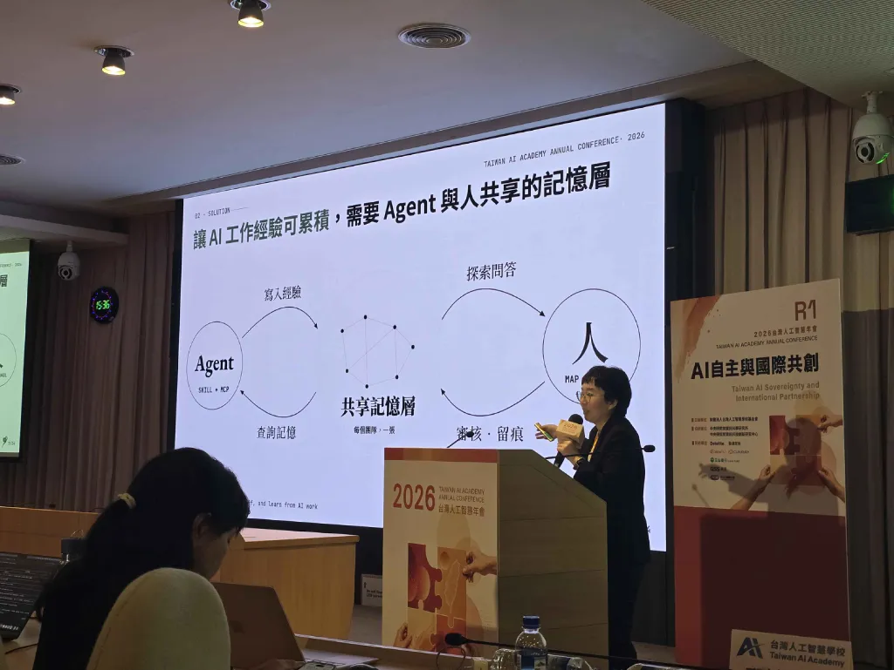
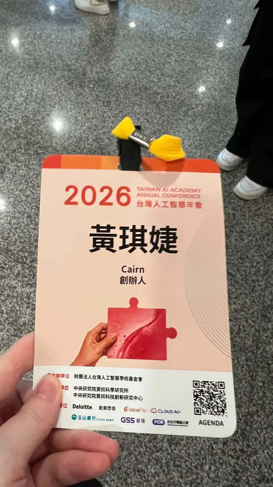

I just wrapped up my talk at the 2026 Taiwan AI Annual Conference (AIA) this week. A big thank-you to Provost Tsai for the invitation, which gave me the chance to share the pain points I've been hitting while working on agent memory.

I met a lot of impressive people there and caught up with plenty of old friends. I'm really glad I got to swap notes with everyone. It was a truly special experience for me 👏

The whole time I've been building Cairn, I've felt that turning AI sessions scattered all over the place into shared team memory really matters. After talking with a few old friends and some developers I'd just met at the venue, I found that a lot of people have the same problem: you hit a bug, ask Claude, close the window, and the next day your coworker has to divine the answer from scratch all over again 😅

If your team is also struggling with how to manage your agents' memory, leave a comment and let's talk 🙌

