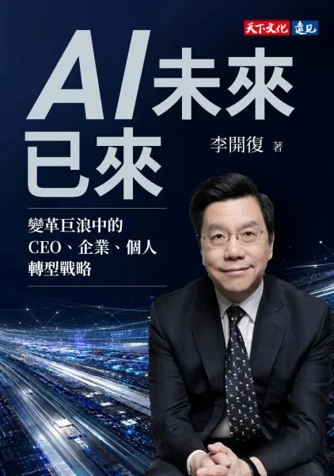

Yesterday a friend and I got talking about Kai-Fu Lee's book *The Future of AI Is Already Here* (my translation of the Chinese title), and the conversation kept throwing up interesting ideas. I finished the book back in September and got a lot out of it. When I wrote an earlier long piece on "why AI coding took off first," I even borrowed its point that "code can be verified by nature."

After that conversation, I went back through the 300-plus highlights I'd made in the ebook. The chapters in the second half on an "enterprise AI decision hub" and a "Boss AI" overlap heavily with what we've been doing since June: Agent Memory for Cairn, and more recently our research into a Company Brain. Plenty of people are talking about Company Brain right now, but there's surprisingly little discussion of what "the CEO's brain" should look like. Since yesterday's chat got me going, I wanted to write one more piece sharing the book's most useful ideas on this, together with what we've learned over the past half year of building.

## Reading a few documents is not the same as understanding a company

When many companies adopt AI, their first move is to dump all their internal policies and historical documents into a vector database and build a knowledge base people can ask questions of. The book points straight at a painful pattern: employees using Doubao or DeepSeek on their own find them pretty useful, so why do these knowledge base tools so often go quiet a while after the company formally rolls them out?

The author uses a vivid image for this. Traditional RAG, he says, is like shredding all your documents first, and then, when you ask a question, digging through the pile of scraps on the floor for a few pieces that "look related on the surface" and gluing them into an answer. That can pull a sentence out of some document for you, but it can't connect things across different systems, different points in time and different business counterparts. Reading a few documents and "understanding a company" are simply two different things.

That's exactly the wall we hit building Moss, our internal Manager Agent. I wanted Moss to help me assign work to our other agents, and once it was running I found the biggest bottleneck wasn't the model's reasoning at all. It was that Moss didn't know the overall state of the company. Feed it a pile of static documents and it's like a new hire on day one with no map of the company: however smart, it just keeps walking into walls.

So what does a decision hub that can really serve as a "company brain" need? The book splits it into four pieces, and I find the breakdown very clear:

- A brain that thinks, meaning the underlying AI model
- A static business map, which the book calls an ontology. It pins down the relationships between customers, contracts, projects, revenue and collections. The newer approach is to let the people who know the business best draw this map directly in natural language, instead of relying entirely on engineers to hand-code the rules
- A real-time navigation system, the "enterprise real-time context." It records, in time order, the transactions, status changes, approval progress and meeting discussions that happen on the map every day, so the system knows what state the company is in right now
- A continuously evolving operating system, built around "skillification." After an expert works through a complex task with multiple agents, the system goes back over the process and distills the steps that worked, and the limits of where they apply, into a skill document that can be reused again and again

Reading the section on skillification, it connected almost directly to the memory evolution we talked about in our Agent Memory series. An experience starts out as a one-off case. After it happens a few times, it gets organized into a strategy for how to do the work. Finally, once it's been validated countless times, it settles into a skill you can call directly. When a company gets these four pieces turning together, organizational memory grows along with the business, instead of staying a pile of dead documents nobody updates.

## Zooming out to the CEO's brain: cutting through the filters so judgment can compound

A while back I went to AppWorks to talk about Company Brain with a few founders. I noticed that most people think about a company brain from the bottom up: how to save frontline sales, product or support staff the time they spend hunting for information and relaying the same messages. What makes this book unusual is that it cuts down from the very top of the pyramid and shows what this brain would look like if it were built for the CEO.

The book shares how the author's team spent six months refining 19 agents and combining them into a "Boss AI." Why does a boss need their own AI? Because the higher you sit in a company, the further you drift from the truth. Bad news tends to get polished layer by layer on its way up until it sounds neutral or even good, and in major meetings people keep up a surface harmony so they don't offend anyone. So the book's Boss AI puts a lot of effort into helping the CEO see through the layers. Before information gets packaged and repackaged, it keeps an unfiltered draft drawn from the raw CRM data, emails, the tone of meeting recordings and document edit histories. On top of that, it comes with a strategic reasoning sandbox. When information is incomplete and the CEO is about to make a call, they can swap in different assumptions and play against themselves ten times first. After the fact, they can use it for a retrospective, so human memory doesn't flatter itself and you don't end up with "when it works, everyone takes credit; when it fails, nobody knows why."

Besides helping the boss see the current situation clearly, the book raises another idea I found really inspiring: "making decision quality compound." In the chapter on AI for the CTO and CAIO, the author designs a "knowledge risk map" that inventories which key technical and business know-how is still locked inside the head of some veteran engineer or executive and hasn't actually made it into any system. In the past, a good judgment call lived only in a senior manager's head, and when they left you started over. But if you can record that decision logic, customer understanding and business context in the system, every good judgment becomes the starting point for the next decision. Future successors could even inherit decades of the company's reasoning.

Over the past half year of building Cairn and researching Agent Memory, we've been dealing with almost exactly the same thing. If memory only records the conclusion "we decided on B," what's left is a cold historical record. What's actually valuable is recording "why we ruled out A, which conditions mattered, and under what assumptions we made this choice," and then connecting the later outcome (feedback) back to it. Only then can an organization's judgment really start to compound the way the book describes. But as soon as we follow this blueprint and actually start writing the system, we run into a very practical engineering problem in everyday data.

## Following the blueprint: once every bit of context is captured, how do you know which statement counts?

When I was laying out a Company Brain architecture earlier, I split it into five layers: capturing context, keeping the reasons, tracking commitments, staying current, and permissions and governance. The book's ideas of global awareness, holding on to decision context and computing a "say-do consistency index" for executives cover the first three layers thoroughly. But after stepping in plenty of holes building memory systems ourselves, we've found the real headaches are usually the last two layers, especially staying current.

Take a scene that plays out every day. Someone asks in Slack, "The client's still stuck. Should we push the delivery date to next Tuesday?" Someone replies with a sticker. Two days later, in a different small meeting, a salesperson says out loud, "Sorted it out with the client. We ship on the original date, but we drop two small features this time." If the system pulls in every conversation, meeting note and document edit trail, how does it tell which line was just a passing suggestion, which was an old alarm that's already been cleared, and which is the final, official commitment?

The book likes to use document edit histories as an example: if a risk warning written by a junior employee gets deleted by their direct manager, the system can flag a hidden risk. But in real work, maybe that risk was confirmed as resolved in another discussion that afternoon, or the employee had misread the client's spec to begin with and the manager simply deleted it after checking. When we were testing the reliability of Agent Memory (the kind of problem research like HaluMem and STALE is tackling), we found models easily swallow phrases like "I think, not confirmed yet" and store the claim as hard fact, or forget to retire old assumptions when a new state appears. If the underlying memory doesn't properly manage "the conditions under which this holds" and "which version is current," the draft that lands on the CEO's desk may well be mixed with a pile of expired misunderstandings 🫠

And even if we get the timeliness and versioning of memory right on the engineering side, once a system that sees every detail is dropped into a real organization, it immediately faces another test, this time of human nature.

## The line between eyes and a surveillance camera: how do you get people to put the truth in the system?

The book is actually very honest about how people react. After introducing a Boss AI that reads emails, meeting tone and edit trails, the author adds a crucial reminder of his own: "Transparency is for shedding light on things, not for scaring people." He also admits that once this line can't be held, the Boss AI degrades from a pair of eyes into a surveillance camera, and surveillance can't win people's hearts. It just drives their real thoughts deeper underground.

Holding that line isn't easy, though. Earlier in the book, while criticizing traditional KPIs, the author had just cited Goodhart's Law: when a measure becomes a target, it stops being a good measure. If employees and managers know that every sentence they delete from a document and the tone they use in meetings will stay in the company's files, and will be used to calculate a "say-do consistency index" and "how often your cross-department input gets adopted" for year-end performance reviews, everyone's instinct will be to protect themselves first 😅 Promises made in public emails and meetings will get more and more cautious, and the discussions that are actually contentious, risky or likely to offend someone will quietly move back to phone calls, private messages and the office pantry.

This has made us even more certain, as we design Cairn and think about Company Brain, that a memory boundary has to be cut into the system architecture from the start. It can't depend on the boss's personal self-restraint. In "When Memory Gets Attacked" and in our recent architecture work, we've kept treating "an individual's working draft (working memory)" and "the company's official memory (Company Brain)" separately. The half-formed ideas, hesitations, complaints and trial and error that come up during a discussion should stay in a safe draft space for the individual or small team. Not every one of them needs to be put in front of the CEO. Once the discussion converges and a decision is really made, someone with the right permissions writes "the official decision, the reasons considered at the time, the assumptions it rests on, and who took on which commitment" into the company's shared memory.

## Building up from low-level memory toward an organizational brain, and meeting the same idea halfway

Looking back on the past half year, the path has been pretty remarkable. We started on Agent Memory in June, building upward from the foundations: how memory forms, how it gets updated, how to make it reliable. When I read the book in September, I saw it working downward from the top of the organization, from the Boss AI and the enterprise decision hub, and I felt then that the problems both sides were trying to solve had met in the middle. Lately I've been talking about Company Brain with more and more founders, and after revisiting the book with a friend yesterday, I realized that many details we'd been turning over and over in engineering and product had already been echoed beautifully in the book, from the CEO's point of view.

What makes this book rare is that the author really runs a company and has really put agents to work through a round of organizational transformation. So its ideas about the "knowledge risk map," "compounding decisions" and "the line between eyes and a surveillance camera" are all lessons you only write after doing the work on the front line 🙌 I'd recommend it to anyone thinking about enterprise AI transformation or curious about Company Brain. If you've read the book, or you've been pushing AI knowledge bases and agents at your own company lately, which idea in it resonates with you most? Come chat in the comments XD
