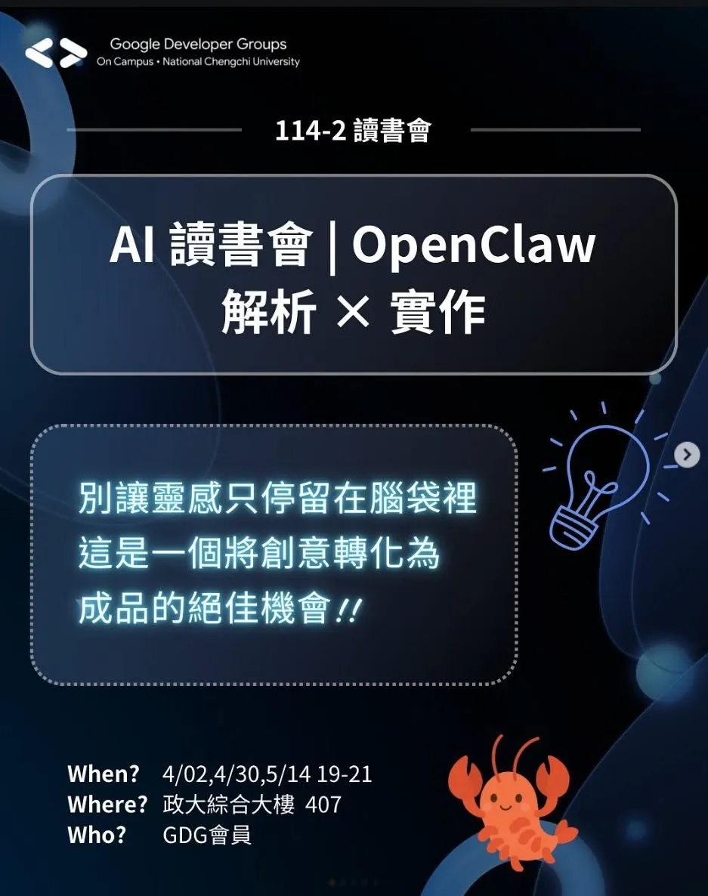

This Thursday I went to GDG On Campus at National Chengchi University (NCCU). For the rest of the semester, I'll be leading the students through a topic I feel strongly about myself: with AI changing so fast, how do we take back ownership of our own thinking?

Honestly, I used to be hit hard by AI FOMO myself. Every day I'd scroll the news, chase new models, and worry about falling behind, and in the end I didn't get anything done well. That's a big part of why I started AILogora. Instead of staying anxious all the time, why not organize all this information so we can digest it together, slowly?

Huge thanks to Chiang for the invitation, and to the students for giving me this chance and a stage to share with all of you 🙌

And to my surprise, I ran into Owen, a teacher I'd only known online through LinkedIn, in person. I'd only ever seen his LinkedIn photos, and just like me, you can't recognize him from his photos. He's better looking in person 🤣

