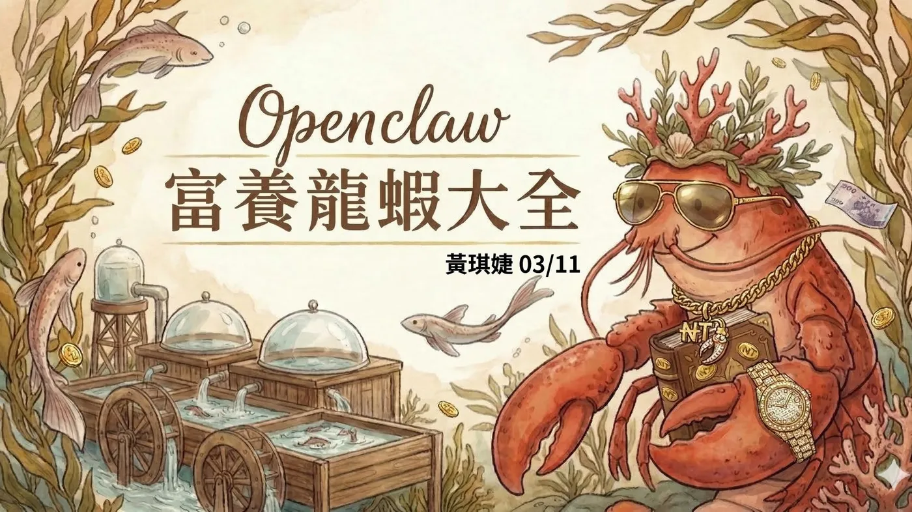
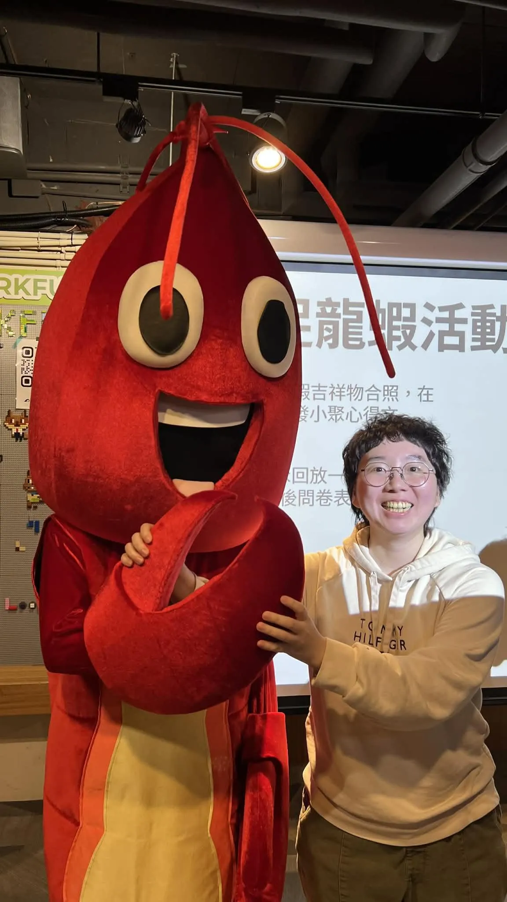
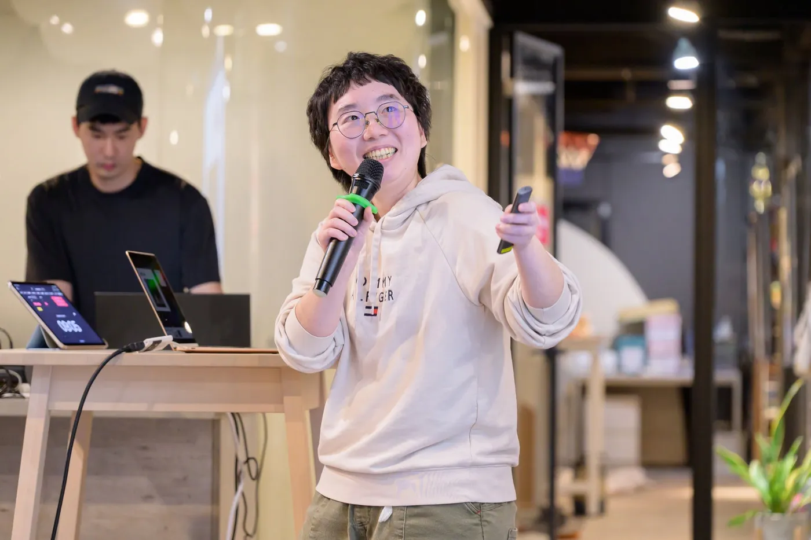
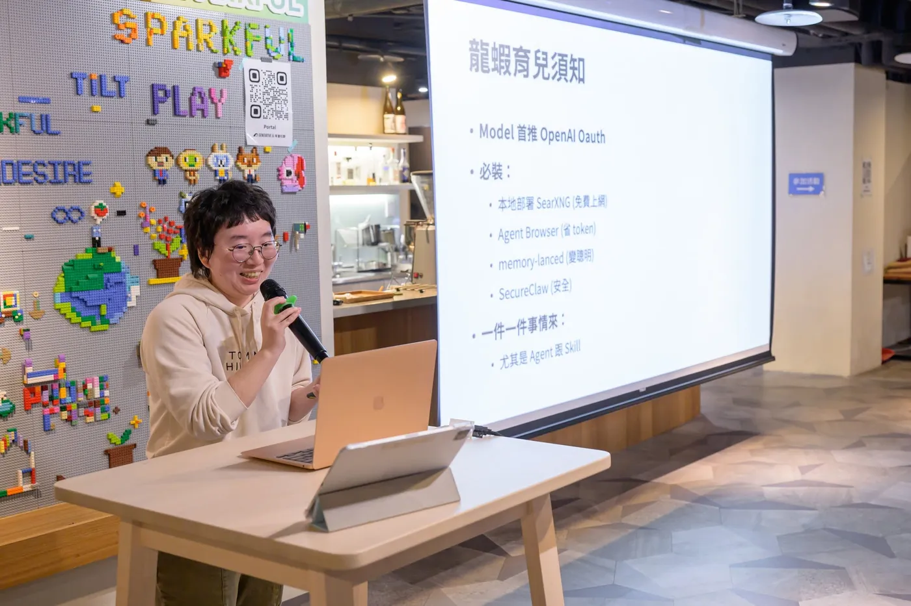
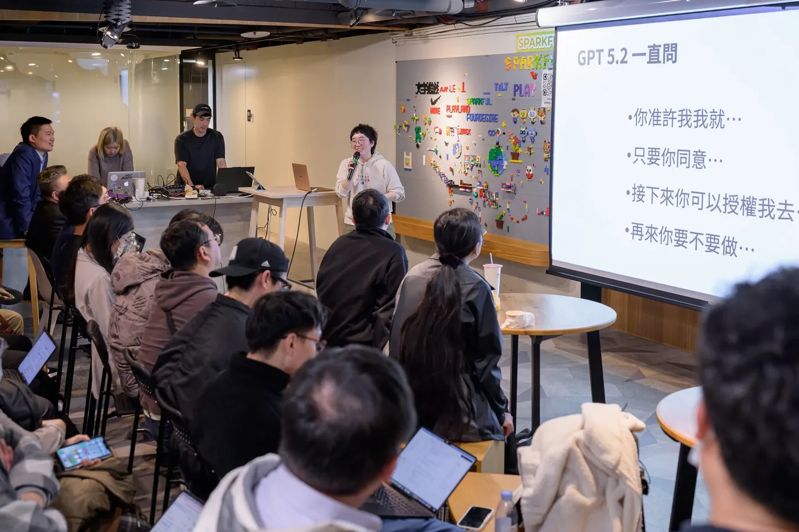

Thanks to Mu-yueh for the invitation. Last Wednesday I got to go back to the GenAI meetup and talk about my lobster.

It's been almost two months since I started raising my lobster (running OpenClaw), and honestly it only gets more fun the more I play with it. I've tried all kinds of weird things, hit plenty of pitfalls, and spent a fair amount of money 😭

The theme this time was "Raising Lobsters, Round Two," and yes, it was totally worth the trip.

For me, the most valuable part of these meetups is never my own talk. It's seeing what everyone else is doing. People's imaginations are wild. Every talk made me think "oh, so you can do it like that" or "oh, so that's how people think about it," and that kind of jolt is really inspiring for me.

I also met a lot of interesting people there and could feel how excited everyone is about raising their lobsters. By my count I've now given four or five lobster talks, so I'm officially a lobster missionary 🤣

And the best surprise: someone actually showed up dressed as a lobster, which was adorable. I kept trying to figure out who was inside, couldn't tell at all in the moment, and only found out after the event that it was Phoebe. I'm dying 😂

