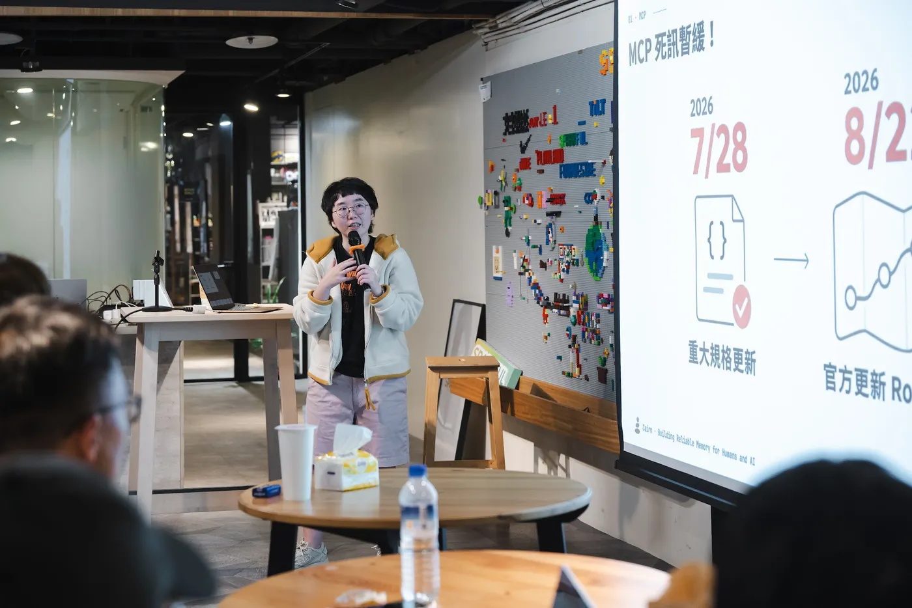
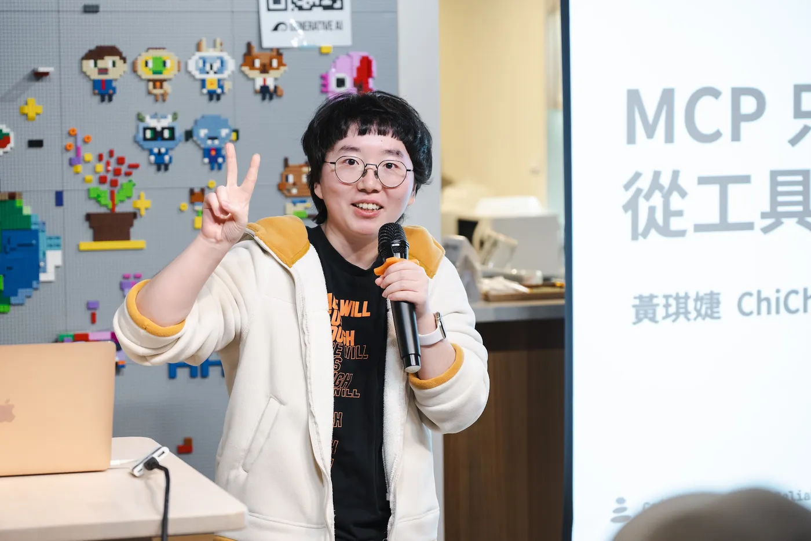
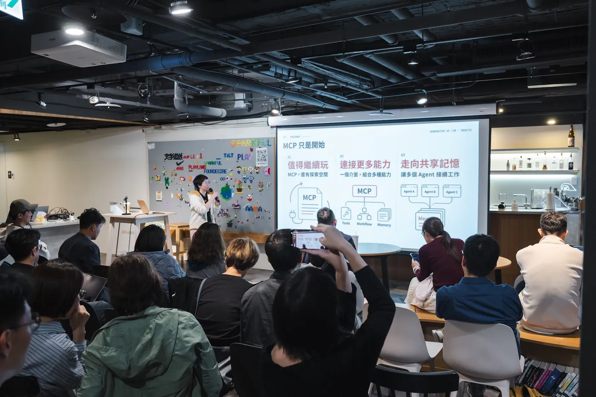

"Does MCP have a future? In a few years, will we be talking about it the way we talk about WAP?"

(If you don't know what WAP is, that's fine. The example has already done its job 😂)

On 11/11 I spoke at the Generative AI meetup on "MCP Is Just the Start: From Connecting Tools to Shared Memory Across Agents," and I opened with that question, which I'd honestly been chewing on for a long time myself 🙌

When I wrote the "Productizing MCP" posts, I was still on the fence about whether this protocol would keep going. Would it become the next USB-C, or the next 3D TV? Plenty of new technologies show up, everyone rushes to build demos and wrap tools around them, and a while later people find they don't hold up in production, and the whole thing ends up as a graveyard of side projects.

But watching it over the past six months, I think it really has been slowly growing from a plain "Connector" into something that looks like "Agent Infrastructure."

Hooking tools up to AI used to mean running one wire to the left and another to the right. We were all switchboard operators. A shared standard saves a lot of that work, but as you install more and more tools, the tool definitions and returned data start flooding the context again.

In the first half of the talk, I went through three common approaches people have been building on top of MCP lately to deal with this:

**① Tool Search: find the tools you need when you need them.**

Instead of stuffing the whole tool catalog into the AI's head up front, let the agent first search for the tools it needs this time, then load only those tool definitions. Anthropic's official example shows roughly an 85% reduction in tool-related context, which leaves the AI some room to do the actual work.

**② Gateway / Router: put one switchboard in front of a pile of services.**

Bring the entry points of different MCP servers together, and let this layer route each request to the right place. It can also centralize authorization, access control and usage logs. What this mainly solves is how services get connected, who can use them and how they're managed. Just adding a gateway won't make the context any smaller on its own.

**③ Backend Code Execution: let code process the data first, then hand back the result.**

Let the agent write code that chains multiple operations together on the backend, filters and organizes the data, and returns only the result needed this time. Cloudflare's Server-side Code Mode, for example, exposes just two tools, search() and execute(), yet behind them it can reach more than 2,500 API endpoints, and the initial tool definitions take only about 1,000 tokens. The front of house looks minimal while the back of house is run off its feet.

On top of that, the official spec update on 7/28 this year made the protocol core stateless, so requests can be spread across different server instances more easily, moving toward something that's easier to scale and deploy. That's an improvement at a different level from keeping data processing on the backend.

The deeper I went, the more convinced I became that there's a lot left to play with once MCP is plugged in. My own angle has been to keep digging into "memory."

The most basic reason I'm digging there is something we slowly realized while building agents: memory almost directly decides how much an agent can understand you and how controllable it is. It also decides whether it can actually carry a whole piece of end-to-end work, instead of only helping you with a small slice each time.

In day-to-day work, what I feel most is that I spend every day as a human mover 🫠 Having several AI windows open at once is normal now, but I'll often work out a whole set of background with Claude, then turn around to hand things to another coding agent and have to explain everything all over again. Where we are now, why we picked this approach, which methods we already tried and failed with. Every day is endless Ctrl+C and Ctrl+V. I bought a whole pile of tools and ended up becoming their logistics center.

So the second half of the talk was mostly about the specific problems I ran into, after hitting pitfall after pitfall, while trying to use MCP to make "shared memory" actually usable:

- **Writing**: With this many conversations, what's actually worth recording? How do you separate an idea tossed around in passing from a decision that's been signed off?
- **Maintenance**: When the direction shifts or a decision changes, how do old memories get updated? If two records contradict each other, which one should the AI listen to next time?
- **Retrieval**: When the next AI takes over, how does it get exactly the context this task needs, instead of rereading a whole mountain of data every time?

In the slides I used a very everyday example: "I usually love spicy food, but this week I'm not eating spicy."

The original preference still stands; there's just an added constraint this week. When another agent helps recommend lunch, it needs to know to look for something non-spicy this time. What you need to remember isn't only the content, but also when and under what circumstances it applies.

If it's just one person, this is fairly simple. Your own second brain, your own rules. But once we want to extend memory from the individual to a team's company brain, a new set of headaches shows up right away: who can see it, who can change it, and when different people and agents disagree, whose word counts.

Looking back, from the early days of brute-forcing it with Markdown and syncing files through GitHub, all the way to now plugging in a memory layer through MCP, I've really been trying to solve the same thing all along: can the experience we already spent time discussing and learning through trial and error be put to use directly the next time we work? Putting the slides together also gave me a chance to do another retrospective for myself, and I realized that writing things down really is only the starting point. What takes more work is what comes after: updating, debugging and managing permissions, so the next person or the next AI can actually take over with confidence.

These days, if I want to test whether a memory setup works, the most direct way is to pick a project I have on hand, record the background, the key decisions and the reasons behind them, and the to-dos, then switch to a fresh conversation or a different AI and see whether it can pick up smoothly without me explaining anything more. Just trying that one handoff usually turns up a pile of context I'd normally been filling in from my own head 😅

Many thanks to the Generative AI meetup organizers for the invitation and arrangements, and thanks to everyone who came to the talk and chatted with me! I've attached a few slides from the day. If you also tend to have several AI windows open and keep switching between them, or you're figuring out how to connect memory across tools, I'd love to compare notes. Hopefully one day the AIs will get better at handing off to each other, and this logistics center can clock out early XD

