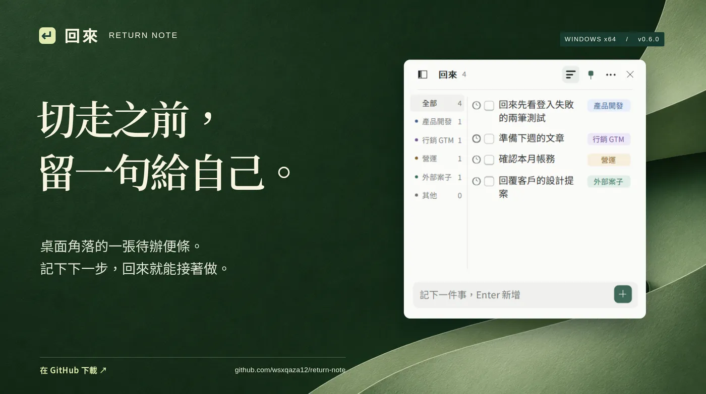

Ever since I started relying heavily on AI for work, I've developed a terrible habit. Every time I send a prompt and wait 15 or 30 seconds for the response, my hands itch to switch to another task. Last year, I kept a book on my desk to read while waiting. This year, I can't control my hands at all 😅

I already have a lot going on throughout the day, and when several threads are AI-related, my attention just constantly jumps between windows. This has been going on for almost a year now. Lately, with things piling up, my brain's cognitive load has completely bottomed out. Whenever I switch over to deal with something else, by the time I switch back, my mind often goes completely blank. I end up staring at the screen trying to remember exactly where I left off. But if I try to hold onto that thought so I don't forget, my brain feels like it's running too many background apps, and I can't focus on the new task either 🫠

To solve this, I looked up some research on task interruptions and "attention residue." I found a very simple solution: when you get interrupted from task A and are about to switch to task B, take a few seconds to write down exactly where you are and what step you need to look at first when you get back. Once the brain knows there's a clear plan to pick up the task later, it's less likely to keep obsessing over it after you switch away.

So for my first version, I built a centralized listener to monitor every AI session and website I was using. Before switching away, I would note down what that session or site was currently doing and where to pick up later. For example, before leaving Claude, I'd leave a note saying, "When you get back, look at those two failed logins first," and rely on the tool to remind me later. After running this for a while, I realized this approach was still too heavy. Work doesn't just happen in places you can monitor. Sometimes I'm editing slides, sometimes I'm using other software. I can't possibly hook up every single tool, and forcing them all together is just too high a maintenance cost.

Later, I just simplified the architecture and built an independent sticky note tool pinned to the corner of my desktop. I named it "Be Right Back." I hooked up AI and voice input. Now, no matter what I'm doing, whenever a thought flashes through my mind or I'm about to switch windows, I can just speak a sentence to jot it down. The AI automatically categorizes it into product development, marketing and GTM, operations, or external projects, saving me the time of organizing it manually.

For the interface, I referenced the quiet, readable styles of apps like Things and Bear. I usually hide the sidebar and secondary actions, leaving only the most prominent to-do text in the bottom right corner of the desktop so it doesn't distract me. I also separated "quick capture" from "start working." Things I just jot down sit there quietly. Only when I actually click an item and get ready to work does it start a timer. If it's a small chore that takes just a few minutes, I can check it off and clear it out as soon as I'm done.

After running this for a few days, my mind feels more focused, and I'm clearing out more tasks every day 🙌 I've seen a lot of people turn their to-do lists into cute idle games or Pomodoro timers, but for this kind of workflow where you have several AI windows open at once, I personally feel the biggest pain point is the moment you switch back. It's all about whether you can immediately pick up the broken thread of your working memory. I'm curious how everyone else manages to control their hands—or restore their memory—during those tens of seconds waiting for AI results XD
