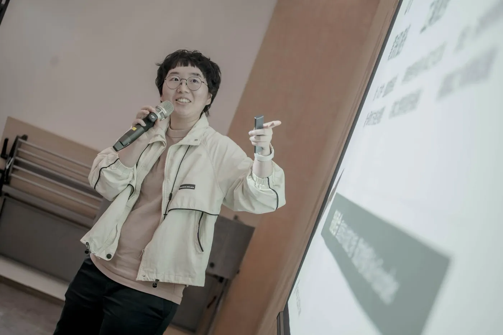
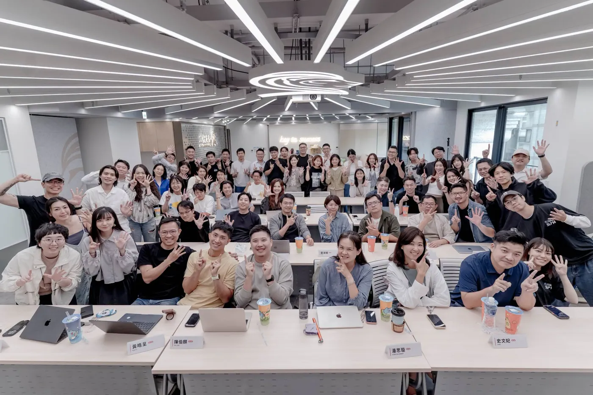
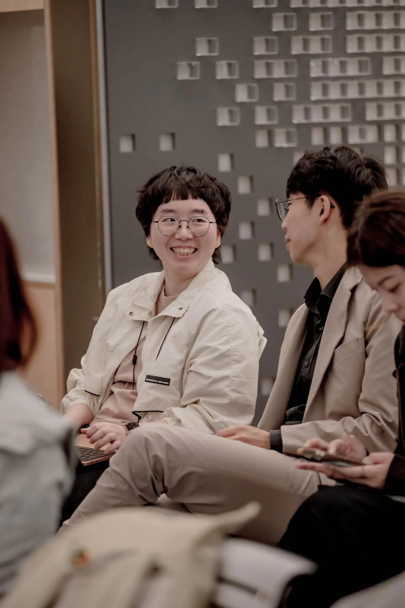
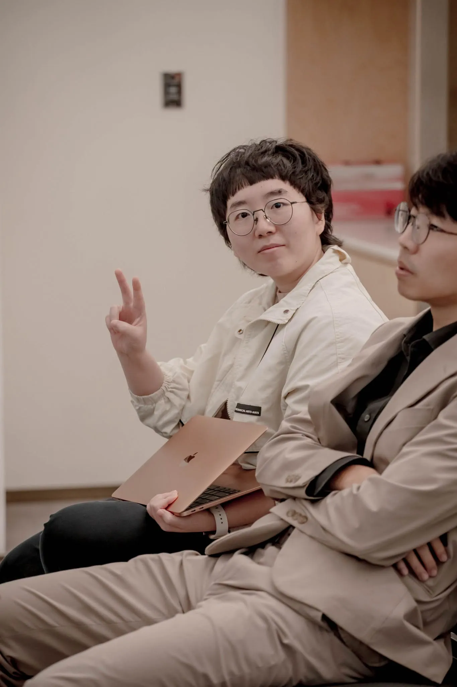

I just wrapped up today's SLP Taipei Mentor Day. Somehow I'm already at the midpoint of my time in SLP, and it has gone by much faster than I expected. I hadn't planned to join any more accelerators or founder communities this year, but one thing led to another, I applied anyway, and I was lucky enough to get in.

I'm not sure if saying this now counts as anti-advertising, since we're about to open applications 🤣 but at first I honestly thought SLP was some mysterious cult, the kind of place where everyone chants slogans together 😅
"Thank you, Master... praise be..."

Once I got in, I found out it's nothing like that. The people come from all kinds of industries, every one of them is interesting and impressive, and they're incredibly willing to help each other.

I've gotten a lot out of my time here. I've met many great founders and mentors, gotten into plenty of fields I'd never touched before, and cleared up a lot of my blind spots as a founder.

Looking back, I'm really glad I decided to join SLP. Besides looking forward to the second half of the program, I'm about to start preparing applications for the 16th cohort with everyone 💪

