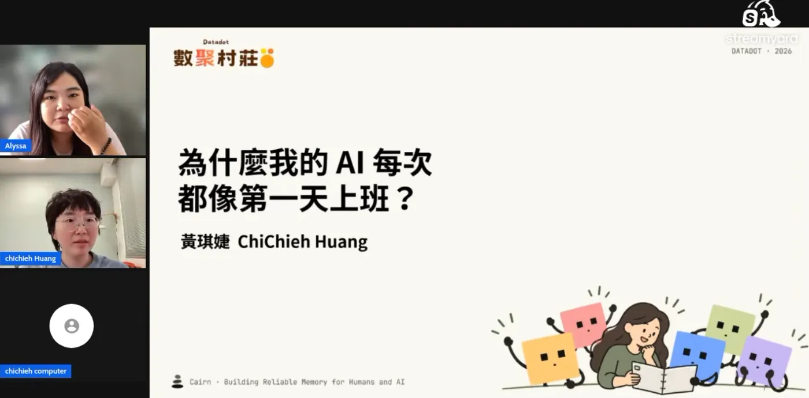

Thanks to Alyssa for inviting me to speak at "AI Impact Day: Good Things Happen in the Data Village" 🙏

When I took this on, I figured the topic would be easy, since I've already given 29 talks this year and have plenty of material on hand. But as I worked on the slides, I realized that most of what I usually say about memory leans toward theory or code, and I've rarely talked about the idea in language that suits a general audience 😅 So I ended up spending quite a bit of time rethinking it, working out how to give everyone something as easy to follow as possible that they'd still get something out of. That's something I need to keep getting better at.

On a side note, I accidentally took on too many talks in November. This was the first of four planned for the month. Next up:
11/5 AppWorks AI Founder Circle #14: The AI-native Company Brain
11/11 Generative AI Conference 2026 meetup
11/15 A meetup on an open-source skills knowledge base for Taiwan's AEC (architecture, engineering and construction) industry

With one more in December, I'm on track for 33 talks this year. Honestly, I have no idea how it got to be this many 🤣

