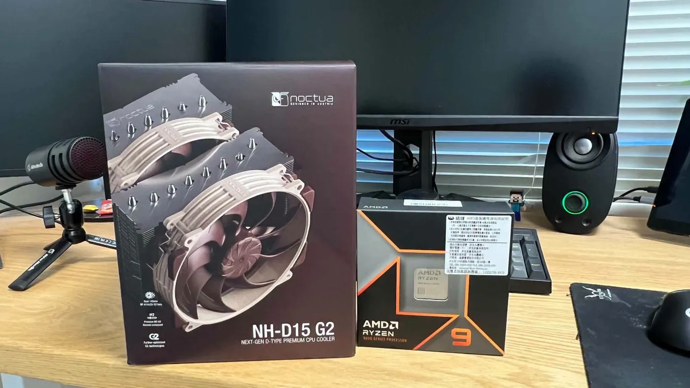
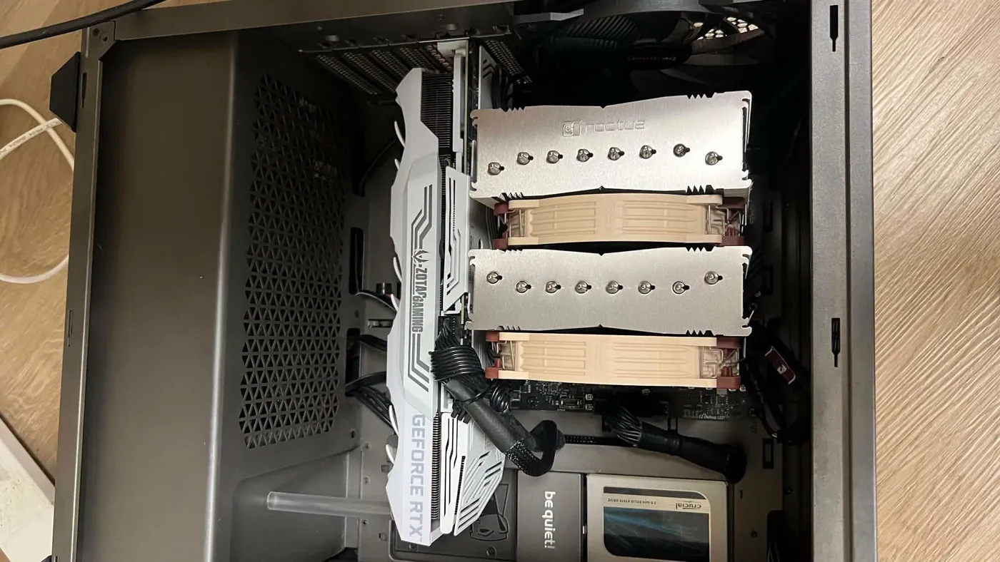

Last time I wrote about digging out the twelve-year-old computers at home to run CI, and I ended on a teaser: in a fit of frustration, I bought a Ryzen 9 9950X for my main machine.

Now that I've been running it for a while, all I can say is that my whole development experience has been completely set free 🙌

I only switched my main machine to an R7 7700 early last year. I figured the compute for writing code all lives in the cloud anyway, so that chip would be plenty for everyday development. Then the way I work changed. My agent now regularly sends out a whole batch of subagents at once, sometimes as many as 33. Those 33 copies are all starting processes, reading and writing files and running commands inside WSL at the same time, and my old setup simply couldn't handle that much concurrency. As soon as they got going, the whole of Windows would start stuttering. Some of it was probably disk I/O too, but every time I switched windows or typed something it would hang for a moment, then hang again, and after enough of that I was ready to snap 😅

Eventually I couldn't take it anymore and went straight to the 16-core, 32-thread 9950X, and while I was at it I added a Noctua NH-D15 G2 tower cooler. I have to say this cooler is amazing at keeping temperatures down, and it's really quiet. Since the switch, even with WSL going full tilt and 33 subagents sent out at once, Windows barely stutters anymore. Watching Task Manager show the load handled with room to spare puts me in a great mood.

By the way, when I moved to the AM5 platform early last year I happened to buy 64GB of DDR5. At the time I thought it was a bit much, but looking back it was a great call. Otherwise, launching thirty-odd copies would have blown through my memory too.

It's kind of funny when I think about it. When I used to see people buy a top-end CPU and a flagship tower cooler like these, it was usually to play games on max settings or render 3D. I bought this setup just so my mouse wouldn't lag while I raise this pack of subagents on my local machine 🤣

I'm curious: for those of you running this many agents on your computer at once, what level of CPU and memory did it take before it felt like enough? Lately I've been wanting to set up yet another machine. I think I've gone off the deep end XD

