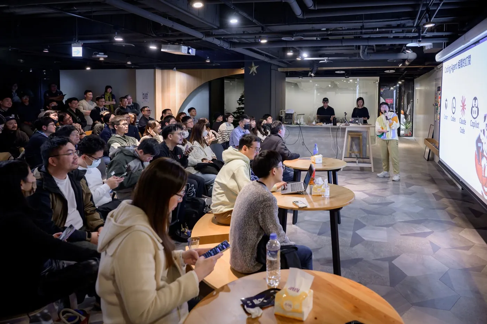
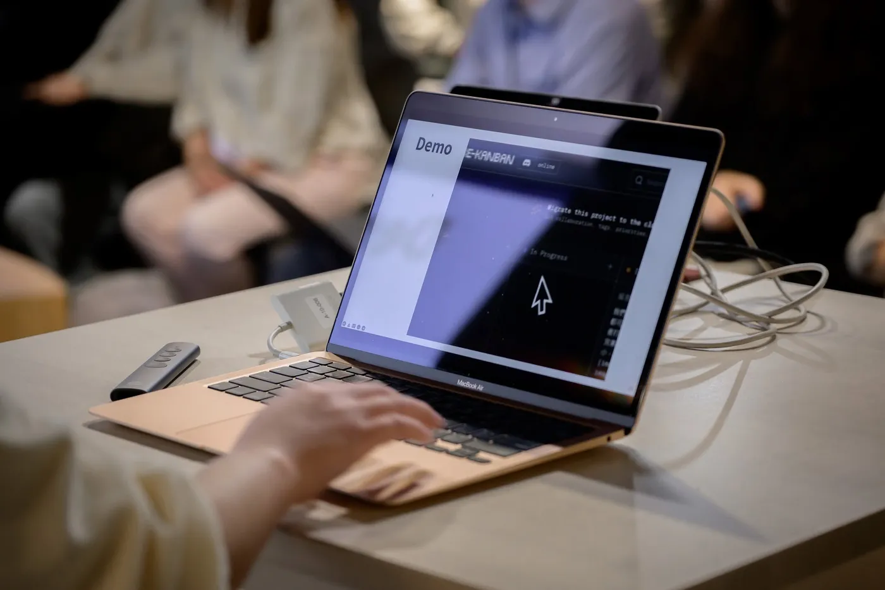
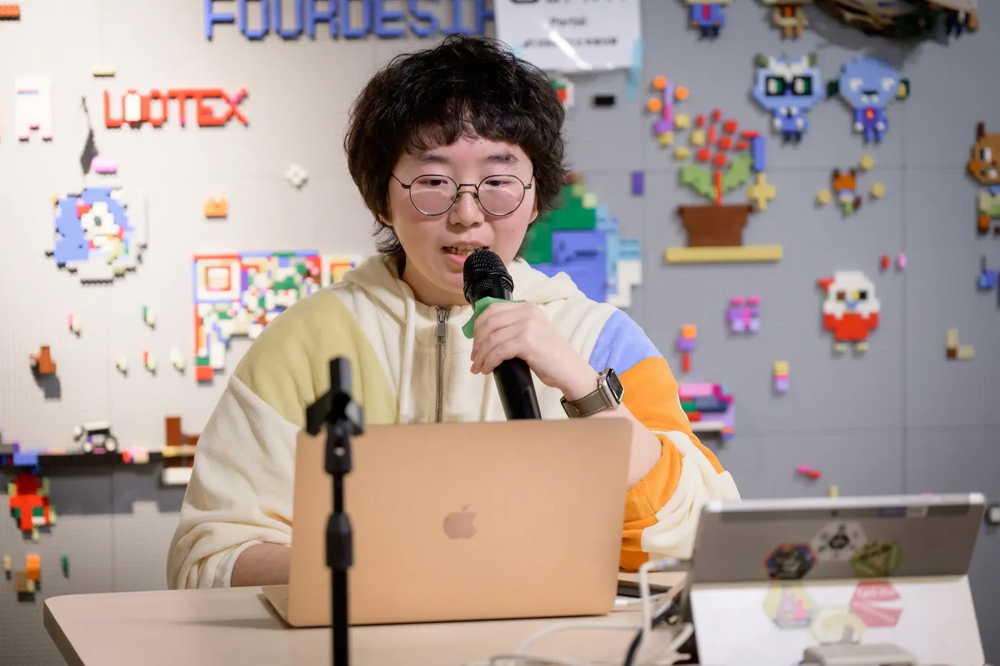
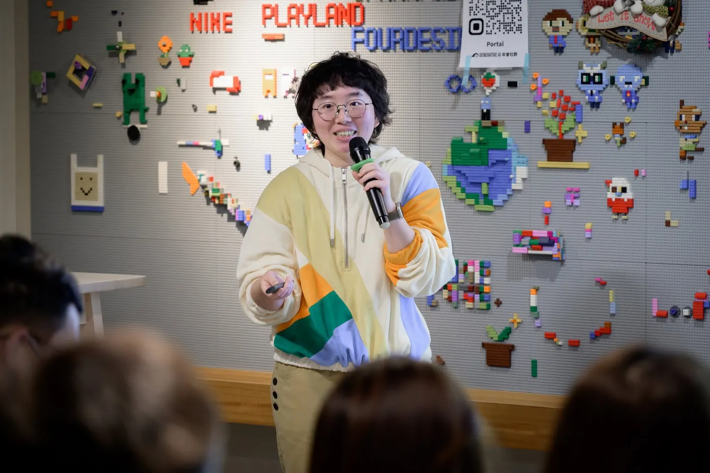

Thanks to the GenAI team for giving me the chance to share how I combine Vibe kanban and Tailscale.
Through January and into early February, this combo boosted my productivity two to three times over, if not more.

I highly recommend it. One caveat: Vibe kanban has been moving toward the cloud lately, and I'm sticking with a local setup, so I'm on version 0.1.13. If you want the same, write down that version number so you don't get forced into a migration to the cloud.

Overall I think this thing is incredibly useful. Vibe Kanban already has worktrees built in, and on top of that it gives you a visual kanban board, so when you work through a project and finish a pile of tasks, it's genuinely satisfying. The best part is that it lets you use different coding agents, which is super convenient for someone like me who subscribes to a lot of them (okay, honestly, I subscribe to all of them).

Huge thanks to the GenAI meetup for having me and letting me share this with everyone. I'm also grateful they invited me to talk tomorrow about my experience raising my lobster (running OpenClaw). I think I've spent something like US$800–900 on it so far, and I can't wait to share how I use it and all the little tricks I've picked up.

And thank you all for the feedback. I had a great time!

